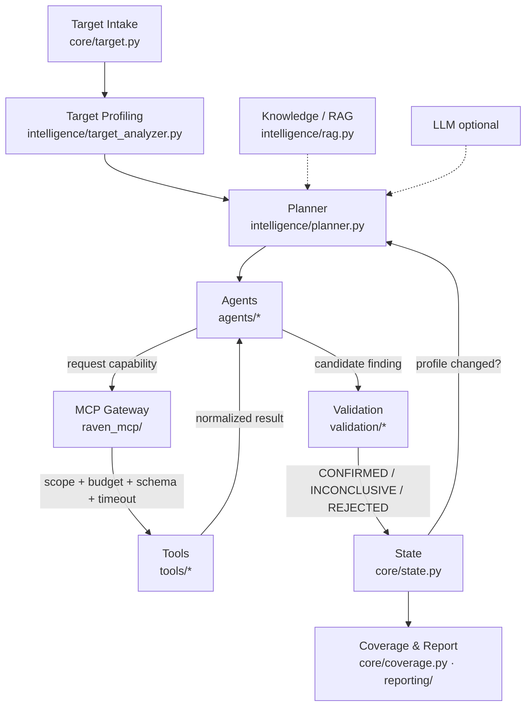

# Raven — Autonomous Security Assessment Platform

Raven assesses an **authorized** target — a web application, a network service, a local source tree, or a
local binary — by working out what the target is, planning capability-based tests, executing them through a
scoped and budgeted tool gateway, **independently validating** every candidate finding, and reporting
**honest coverage**. It never treats "no findings" as "secure".

```
observe → understand → plan → act → observe → update context → re-plan
```

> **Status:** v5.0.0, first public release. Feature-frozen. It is a working, tested assessment engine with
> deliberately bounded scope — see [Supported targets](#d-supported-targets-and-capabilities) and
> [Limitations](#l-limitations-and-roadmap) for exactly what is and isn't implemented.

> ⚠️ **Authorized use only.** Assess only systems you own or have explicit, written permission to test. See
> [Security and responsible use](#k-security-and-responsible-use) and [`SECURITY.md`](SECURITY.md).

---

## A. What Raven is

Traditional scanners run a fixed checklist and call a target "clean" when nothing matches. That is misleading:
"no finding" usually means "not looked at", not "secure". Raven is built around the opposite premise.

- **Adaptive & agentic.** Raven observes the target, forms a profile of what it is, and re-plans its work
  every iteration as it learns more (a discovered API endpoint or open port changes the plan).
- **Evidence-based.** An agent can only ever raise a *candidate*. A separate validator independently
  re-observes the target and must reproduce the behaviour before anything is reported as CONFIRMED.
- **Honest about coverage.** Every applicable attack surface is reported with a coverage status. An
  unassessed surface is reported as `NOT_ASSESSED`, never as clean.

It supports **web applications, REST APIs, GraphQL endpoints, network services, source repositories, and
local binaries**. An LLM is optional — without one Raven runs fully rule-based.

## B. Key features

- **Adaptive assessment loop** — `observe → understand → plan → act → observe → update context → re-plan`,
  re-planning whenever the target profile changes.
- **Target profiling & planning** — a deterministic, explainable planner ranks work by priority, cost and
  discovery order from the profile, available tools, remaining budget and history.
- **Eight specialized agents** — web recon, web security config, web exposure, active injection, network
  recon, service assessment, source assessment, and static binary assessment. Agents request *capabilities*,
  never tools directly.
- **MCP Gateway & Tool Registry** — every tool call goes through one gateway that resolves a capability to a
  registered tool, validates arguments against a schema, enforces scope and budget, applies a timeout,
  normalizes the result, and logs it.
- **Scope validation & authorization** — scope is derived from the target; anything you did not point Raven
  at is out of scope. Active testing requires you to raise the risk ceiling explicitly.
- **Budget management & recovery** — per-run limits on tool calls, time and iterations; failures are
  classified and recovered (retry / backoff / alternative tool / corrected args / skip / block), all recorded.
- **Independent finding validation** — a dedicated validator re-probes each candidate; only it can move a
  finding to CONFIRMED / INCONCLUSIVE / REJECTED. Secrets are redacted before they reach state or a report.
- **Persistent state & resumption** — state is the single source of truth, atomically persisted; an
  interrupted assessment can be resumed by ID without repeating completed work.
- **Coverage tracking & reporting** — coverage is computed from what actually ran; one honest report
  pipeline emits Markdown + JSON.
- **Knowledge retrieval (RAG)** — checklists, prior cases and validated lessons are retrieved by current
  context (lexical BM25) to inform planning.
- **Reproducible benchmark** — `python -m benchmark` runs the real pipeline against controlled fixtures and
  scores detection, coverage, false positives and report consistency.

## C. Architecture

Assessment flow:

```
Target Intake → Target Profiling → Planning → Agent Execution → MCP Gateway → Tool Execution → Validation → Coverage & Reporting
                                        ▲                                                              │
                                        └───────────────── re-plan on new knowledge ◄─────────────────┘
```



| Layer | Package | Responsibility |
|---|---|---|
| Intake | `core/target.py` | Parse/normalize input; never tests anything |
| Analysis | `intelligence/target_analyzer.py` | "What am I looking at?" → `TargetProfile` |
| Knowledge (RAG) | `intelligence/rag.py`, `context.py`, `lessons.py`, `knowledge/` | Checklists, cases, validated lessons; retrieved by *current context* |
| Planner | `intelligence/planner.py` | Chooses next work from profile + tools + budget + history; re-plans every iteration |
| Agents | `agents/` | Propose tasks, request **capabilities** (never tools) |
| MCP gateway | `raven_mcp/` | Capability→tool resolution, arg validation, **scope**, **budget**, timeout, normalization, logging |
| Tools | `tools/` | Concrete scanners registered with capability metadata in `tools/catalog.py` |
| Validation | `validation/` | Re-observes the target; SPA/response baselines; content signatures; redaction |
| Recovery | `recovery/` | Classifies failures → retry / backoff / alternative tool / correct args / skip / block (recorded) |
| State | `core/state.py` | The single source of truth; atomic persistence |
| Coverage | `core/coverage.py` | Computed from what actually ran |
| Report | `reporting/` | One honest report pipeline (Markdown + JSON) |
| Runtime | `core/assessment.py`, `core/runtime.py` | The adaptive loop (small, testable stages) |

Separation of duties: RAG = knowledge · LLM = reasoning · Planner = decisions · Agents = specialized
behavior · Gateway = controlled tool access · Scope/Budget = boundaries · Validator = evidence ·
State = truth · Report = output. The LLM can *never* override scope, budget, tool schemas or validation.

## D. Supported targets and capabilities

| Target | Point Raven at | Implemented capabilities | Mode | Key limitations |
|---|---|---|---|---|
| **Web application** | an `http(s)://` URL | exposed paths/files, admin-panel/actuator/config exposure, security headers, cookie flags, CORS reflection, SPA-fallback detection | passive | not a crawler; authenticated testing not implemented |
| **REST API** | discovered from the web target (OpenAPI/Swagger, forms, path `id`s) | input-surface discovery + active SQLi / reflected XSS / SSRF | **active** (needs `--max-risk moderate`+) | only parameters Raven actually discovered; not a fuzzer |
| **GraphQL** | a `/graphql` endpoint with introspection enabled | query-argument discovery + active SQLi / SSRF | **active** (`--max-risk moderate`+) | mutation-argument testing and GraphQL XSS are **not** done (documented gaps) |
| **Network service** | `host:port` or an IP | port/service identification, protocol probing, unauthenticated-service detection | passive / low | limited protocol set |
| **Source repository** | a local directory | hardcoded secrets, vulnerable dependencies, unsafe-code patterns, insecure configuration, file permissions | static | pattern-based; static hits stay INCONCLUSIVE until data flow is shown; file permissions POSIX-only |
| **Binary executable** | a local ELF / PE / Mach-O file | format/arch identification, header hardening indicators, imported libraries, embedded-string inspection, file permissions | **static only** | never executed; PE import-table & Mach-O hardening/imports not implemented |
| Containers / Cloud / Kubernetes | — | classified only | — | **no agents implemented** |

Active injection (SQLi / reflected XSS / SSRF) is **off by default** and only runs at `--max-risk moderate`
or higher; below that it is recorded as an explicit limitation, never silently skipped. Not implemented at
all: authorization/access-control testing, authenticated testing, and injection types beyond SQLi/XSS/SSRF.

## E. Installation

**Requirements:** Python **3.11+** (developed and tested on 3.11; POSIX or Windows). No external services are
required.

```bash
git clone <your-fork-or-clone-url> raven && cd raven
python -m venv venv
source venv/bin/activate            # Windows: venv\Scripts\activate
pip install -r requirements.txt     # runtime deps
pip install -r requirements-dev.txt # additionally: pytest (for the test suite)
```

Runtime dependencies: `typer`, `rich`, `pydantic`, `httpx`, `cryptography`, `ollama` (the Python client;
a running Ollama server is optional — see below).

## F. Configuration

An **LLM is optional**. Without one Raven runs fully rule-based; with one it helps interpret the target and
prioritize tasks (it can never override scope, budget, tool schemas or validation).

- **Configure an LLM (optional):** `python raven.py setup` runs an interactive wizard for a local (Ollama)
  or API-based model.
- **Where config lives:** `~/.raven/config.json` (**outside the repository**). `config.example.json` in the
  repo shows the format with placeholder values only. An API key you provide is stored there, encrypted at
  rest via `config/keystore.py` — **never** committed to the repo.
- **Local assessment data:** saved state lives under `~/.raven/assessments/<id>/`. Set `RAVEN_HOME` to
  override the location.
- **Avoid committing credentials:** the repo's `.gitignore` excludes `.env`, a repo-level `config.json`, and
  `~/.raven` data. Keep real keys in `~/.raven/config.json`; never paste them into the repo.

## G. Usage

```bash
python raven.py                       # interactive menu
python raven.py version               # version / banner
python raven.py --help                # all commands and options
python raven.py setup                 # configure an optional LLM
```

Run an assessment (all examples target local / intentionally vulnerable systems — **you must be authorized**):

```bash
# Web app, quick passive pass
python raven.py assess http://localhost:3000 --depth quick

# Enable active SQLi / XSS / SSRF probing (raises the risk ceiling)
python raven.py assess http://localhost:3000 --max-risk moderate

# Local source tree, fail CI on a high-severity confirmed finding
python raven.py assess ./my-project --fail-on high --yes    # --yes = "I am authorized" (non-interactive)

# Local binary
python raven.py assess ./bin/app.elf

# Network service
python raven.py assess 127.0.0.1:6379
```

Common options (verified against `cli/app.py`):

| Option | Values | Meaning |
|---|---|---|
| `--depth`, `-d` | `quick` \| `standard` \| `deep` | budget preset (≈45 / 120 / 400 tool calls) |
| `--max-risk` | `passive` \| `low` \| `moderate` \| `high` | risk ceiling; `moderate`+ enables active injection |
| `--fail-on` | `critical` \| `high` \| `medium` \| `low` \| `none` | non-zero exit if a confirmed finding meets the threshold |
| `--output`, `-o` | directory | where to write the `.md` / `.json` report |
| `--yes`, `-y` | flag | confirm authorization non-interactively (for CI) |
| `--resume` | assessment ID | resume a saved assessment |

Aliases: `scan <path>` and `pentest <path>` are thin wrappers around `assess` kept for scripts/CI.
`report <assessment-id>` re-displays a past report.

```bash
python raven.py assess --resume ASM-1a2b3c4d     # continue an interrupted run (target loaded from state)
python raven.py report ASM-1a2b3c4d              # re-display its report
```

## H. Assessment workflow

When you start an assessment, Raven:

1. **Intakes** the target and derives its **scope** (only what you pointed it at) and risk ceiling.
2. **Profiles** the target (type, technologies, surfaces, reachability) into a `TargetProfile`.
3. **Plans** the highest-value work deterministically from the profile, available capabilities and budget.
4. **Executes** agents, which **request capabilities** through the MCP gateway. The gateway checks scope and
   budget, validates arguments, runs the tool with a timeout, and normalizes/logs the result.
5. **Validates** each candidate finding independently — re-observing the target and requiring the behaviour
   to reproduce before confirming it. Failures are classified and recovered (retry, backoff, alternative
   tool, corrected args, skip, or block), all recorded.
6. **Re-plans** whenever new knowledge changes the profile (a new endpoint, port, or technology), then
   repeats until the budget or iteration limit is reached.
7. **Computes coverage** from what actually ran and writes one honest **report** (Markdown + JSON).

Expect the run to print each task, its result, and validation verdicts as it goes, then a summary with an
assessment ID and the report path. If the target is unreachable, Raven records a limitation rather than
reporting anything as clean.

## I. Understanding reports

Reports are written to `raven_reports/raven_<id>.md` and `.json` (or your `-o` directory).

**Findings:**
- **CONFIRMED** — an independent re-check reproduced the behaviour with evidence.
- **INCONCLUSIVE** — a signal was seen but exploitability was not proven (e.g. a static pattern match
  without data-flow). Investigate; do not dismiss.
- **REJECTED** — a candidate that failed independent validation (a filtered false positive), reported as a
  count so you can see it was considered.

**Coverage** (per surface, separate from findings):
- **ASSESSED** — a test ran to completion.
- **PARTIALLY_ASSESSED** — ran, with gaps.
- **NOT_ASSESSED** — no test ran. **Never interpret this as secure — it means "not looked at".**
- **BLOCKED** — applicable, but the platform/tool made it impossible (e.g. POSIX-only permission auditing on
  Windows).
- **NOT_APPLICABLE** — the surface does not exist for this target type.

"No confirmed findings" is always qualified by how much was actually assessed. Raven never prints a "clean"
verdict.

## J. Benchmark and testing

```bash
# Full test suite (unit + integration against real local servers + regression)
pip install -r requirements-dev.txt
python -m pytest -q

# Reproducible assessment benchmark
python -m benchmark                     # run all scenarios + summary
python -m benchmark --list              # list scenarios
python -m benchmark --scenario ID ...   # run a subset
python -m benchmark --out results.json  # also write machine-readable results
```

The benchmark runs the **real** pipeline against controlled, local, authorized fixtures (web exposure,
web-security config, REST + GraphQL input testing, network service ID, source secrets/deps/config/perms,
static binary analysis) with positive, negative, inconclusive and partial/gated cases. It measures: whether
the expected capability ran, whether the expected finding was produced *and independently validated to the
expected verdict*, whether coverage was classified honestly, a false-positive gate (nothing confirmed in
negative cases), and report↔state consistency.

**Verified results at v5.0.0** (`git tag v5.0.0`):
- Test suite: **259 passed, 1 skipped** (the skip is the POSIX-only SUID file-permission test).
- Benchmark: **12/13 scenarios pass, 1 POSIX-only skip, 0 failures, 0 unexpected confirmations**
  (detection 30/30, coverage 18/18, false-positive gate 6/6, report 41/41).

This is a **small, controlled fixture benchmark**. It establishes *repeatable behaviour on a defined set of
scenarios* — it is **not** a real-world detection-rate guarantee and makes no claim about arbitrary targets.

## K. Security and responsible use

Raven is for systems **you own or are explicitly authorized to assess**. It derives scope from the target and
refuses out-of-scope tool calls; active injection is gated behind an explicit `--max-risk moderate`+; probes
are controlled and non-destructive (boolean/error-based SQL, a single reflected XSS canary, SSRF via a
loopback callback). Even so, active testing generates real traffic — run it only against systems you control
or are authorized to test. See [`SECURITY.md`](SECURITY.md) for the full policy and how to report a
vulnerability in Raven itself.

## L. Limitations and roadmap

**Current limitations (implemented behaviour):**
- Authorization/access-control testing, authenticated testing, and injection types beyond SQLi/XSS/SSRF
  (command injection, XXE, template injection, …) are **not implemented** — they appear as `NOT_ASSESSED`.
- Active injection only exercises discovered parameters and only at `--max-risk moderate`+; SSRF confirmation
  depends on the target reaching Raven's loopback callback, which is not true across most network boundaries.
- GraphQL: query-argument SQLi/SSRF only; mutation-argument testing and GraphQL XSS are not done.
- Binaries: static-only (never executed); PE import-table and Mach-O hardening/imports are not implemented.
- File-permission auditing is POSIX-only (reported `BLOCKED` on Windows).
- Knowledge retrieval is lexical (BM25), not embedding-based.

**Not yet implemented (classified but no agents):** container, cloud, and Kubernetes targets. These are
possibilities, not commitments — no dates or guarantees are implied, and nothing above is described as
available when it is not.

## M. Contributing

Contributions are welcome. A typical change is one agent class + one tool + one validator (no core changes):

1. Add a tool in `tools/catalog.py` (`ToolDefinition` with capabilities, schema, risk level, scope args).
2. Add an agent (`agents/base.py::Agent`: `applies()`, `propose_tasks()`, `run()`) and register it in
   `agents/registry.py`.
3. Add a validator (`_v_<signal>` in `validation/`) for any finding type it emits.

Please run `python -m pytest` and `python -m benchmark` before opening a pull request, and add tests for new
behaviour. See [`CONTRIBUTING.md`](CONTRIBUTING.md).

## N. License and acknowledgements

Licensed under the **MIT License** — see [`LICENSE`](LICENSE). Copyright (c) 2026 Raven Contributors.
