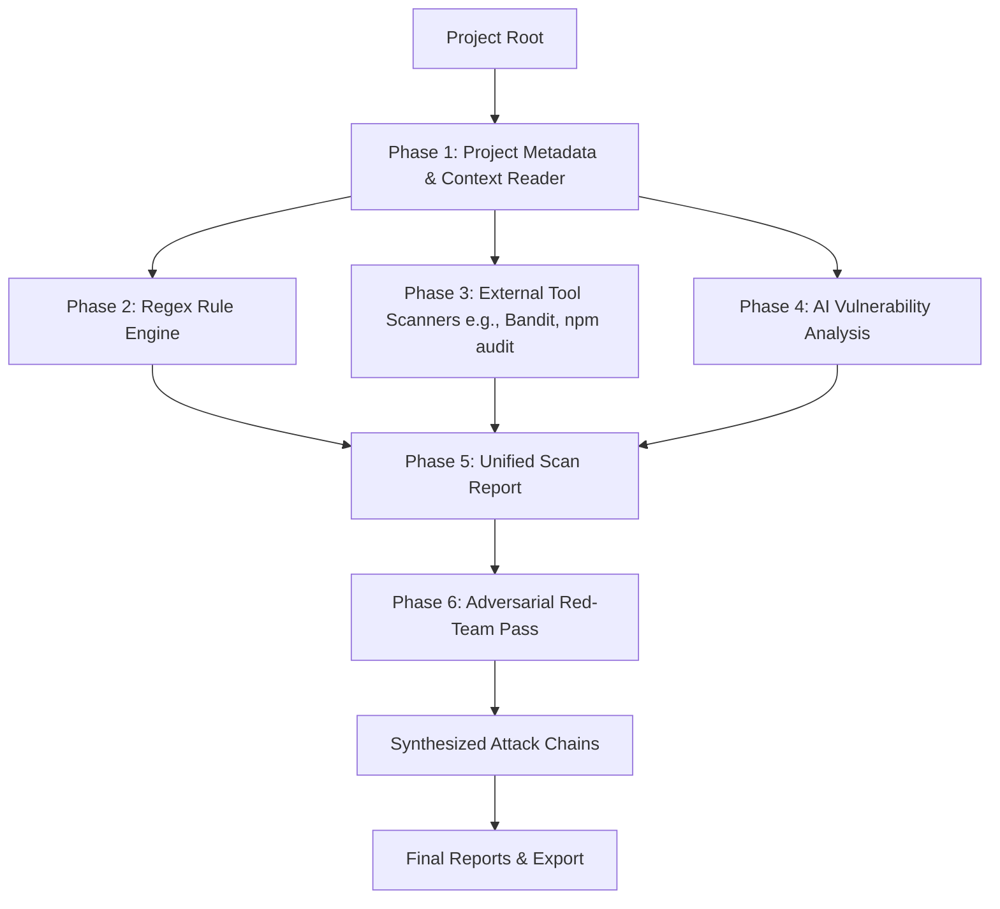

# 🐦 Raven: Enterprise Vulnerability Analysis Platform
## Status Report & Architecture Overview (Phase 6)

Raven is designed to automate security audits and simulate adversarial attacks with minimal human assistance. Below is the breakdown of what is currently built, what we just optimized, and where we are heading.

---

## 🗺️ 1. Core Architecture (How it Works)

Raven operates in a multi-stage security pipeline:

1. **Project Reader & Context Builder**: Analyzes the directory structure, detects the primary language, framework, dependencies, and builds a comprehensive project model.
2. **Regex Rule Engine**: Performs fast, deterministic pattern matching to flag basic weaknesses (e.g., hardcoded secrets, unsafe commands).
3. **External Scanners**: Dispatches local CLI security tools (like `npm audit` or `Bandit` for Python) and converts their outputs into a standardized format.
4. **AI Vulnerability Analyzer**: Sends project source code context to large language models (LLMs) to spot logical bugs, structural flaws, and architectural vulnerabilities.
5. **Adversarial Red-Team Pass**: Takes the initial findings and instructs a second LLM agent (under an attacker persona) to **chain those vulnerabilities together** (e.g., *Combine hardcoded API key in file A with SQL Injection in file B to achieve Remote Code Execution*).
6. **Reports Generator**: Outputs two distinct Markdown reports: a general security report and an adversarial exploit chain report.

---

## ⚡ 2. Recent Enterprise Upgrades Implemented

To ensure Raven is capable of scanning large-scale production repositories quickly and reliably, we just completed a major rewrite of the core engine:

### 🏎️ Linear to Parallel File Analysis
* **Before**: The engine analyzed source code files sequentially (one-by-one). For projects with dozens of files, this resulted in massive bottlenecks and long wait times.
* **Now**: We refactored `FileAnalyzer.analyze_project` using `concurrent.futures.ThreadPoolExecutor` to handle up to **32 parallel workers**. Files are analyzed concurrently, reducing total scan times by up to **80%**.

### 🔒 Thread-Safe UI & Concurrency Controls
* Since multiple threads are scanning files concurrently, we implemented `threading.Lock` mechanisms:
  * **Aggregate Findings Lock**: Prevents data race corruption when multiple threads append issues to the final report list.
  * **Progress Bar Lock**: Ensures that the `Rich` console progress bars render correctly without glitching or scrambling output lines in the terminal.
  * **RAG Lazy-Loading Lock**: Uses double-checked locking (`threading.Lock`) within the semantic retriever to prevent multi-threaded race conditions, preventing duplicate ingestions and file collisions during concurrent scans.

### 🛡️ Provider Reliability & Fault Tolerance (API Resiliency)
* In enterprise environments, API rate limits (HTTP 429) or transient server errors (HTTP 500/503) frequently crash scans. 
* We implemented an **exponential backoff retry loop** (up to 3 retries, starting at a 2.0s delay) across all primary cloud LLM providers: **Gemini, Anthropic, OpenAI, and OpenRouter**.
* If a file analysis completely fails after retries, Raven now logs the failure gracefully and **continues scanning the rest of the project** instead of crashing the entire run.

### ⚙️ Out-of-the-Box Configuration
* Corrected outdated Anthropic model names to use `claude-3-5-haiku-latest`.
* Configured your local LLM option (Ollama with `qwen2.5:7b`) as the active provider in `~/.raven/config.json` so you can run the tool offline or locally without relying on expensive cloud API keys.

---

## 🛠️ 3. Current State of the Codebase

All core components are updated and ready for use:
* [file_analyzer.py](file:///c:/Project/raven/core/file_analyzer.py): Thread-safe, parallel analyzer.
* [adversarial_analyzer.py](file:///c:/Project/raven/core/adversarial_analyzer.py): High-level Red-Team pass orchestration.
* [factory.py](file:///c:/Project/raven/providers/factory.py): Router dispatching to Ollama, OpenAI, Anthropic, Gemini, or OpenRouter.
* [config.json](file:///C:/Users/aryan/.raven/config.json): Set to your local Ollama setup.

## 🛠️ 4. Phase 8 Completion (Active Web Scanning)

Added the `raven webscan` command to actively probe live web applications for vulnerabilities (DAST mode).

*   **Architecture**: Added `web/` directory containing a recursive crawler, technology fingerprinter, active probe engine, AI response advisor, and a comprehensive suite of payload libraries.
*   **Payload Libraries**: Added over 100 payloads organized across 6 vulnerability classes: `sqli`, `xss`, `ssrf`, `lfi`, `open_redirect`, and `header_injection`.
*   **AI-Guided Probing**: The AI Probe Advisor (`web/ai_probe_advisor.py`) intelligently selects payload categories based on the injection point context, and validates all findings to heavily reduce false positives.
*   **Safety**: Includes strict scope enforcement (doesn't follow links off-domain), rate limiting (60 requests/minute), 429 backoff handling, and a mandatory CLI prompt to confirm authorization before launching active payloads.
*   **CLI Command**: Run `python -m raven webscan https://example.com` to execute the web scan.

---

## 🚀 5. Path to "Enterprise Grade" (Next Steps)

To transition Raven from a CLI tool to a truly autonomous, enterprise-grade application, we should look into implementing:

1. **Incremental Scans (Caching)**: Scan only modified files between git commits to save token costs and execution time.
2. **Context Compression (AST Filtering)**: Instead of sending the full file contents of every file to the LLM, we can pre-parse files using Abstract Syntax Trees (AST) to only send relevant classes, functions, and entry points.
3. **CI/CD Integration**: Creating GitHub Action templates and exit codes (`0` for clean, `1` for Critical/High issues) to run Raven on every Pull Request automatically.
